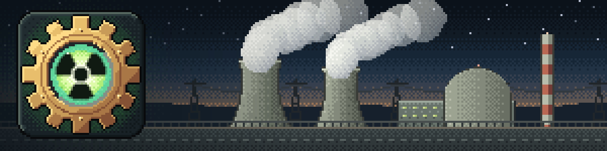

<p align="center"></p>

# Create: Nuclear Industry

A nuclear industry for [Create](https://modrinth.com/mod/create) on NeoForge 1.21.1: mine and enrich uranium, run fission
and pressurized water reactors, light a fusion tokamak, turn their heat into rotation with turbines and cooling towers,
deal with spent fuel and waste, watch it all from a control room, and, if you must, build the weapons and the missile
defence to go with it. Every machine is a Create contraption you power with shafts, feed through pipes and funnels,
and automate.

> **2.0.0 is a beta.** Back up your world before installing or updating, and please report what breaks on the
> [issue tracker](https://github.com/papiricoh/create_nuclearindustry/issues).

## What's in it

**Fuel cycle**
- Uranium and thorium from ore through crushing, washing, acid leaching, yellowcake, gas centrifuge cascades and fuel
  fabrication; lithium from spodumene, deuterium and heavy water by electrolysis.
- Two bulk fan treatments next to Create's, acid leaching and irradiation, and ore-free routes to the base
  materials.

**Fission**
- A multiblock fission reactor with real temperatures, rods you drive with pistons, xenon, decay heat, SCRAM, safe
  shutdown and refuelling outages; a viewport to watch the core glow.
- Pressurized water reactors with a pressurizer, primary coolant and steam generators, and accidents that go wrong the
  way they would: cladding oxidation, corium, containment.
- Radioisotope generators for small, steady rotation.

**Fusion**
- A toroidal tokamak with vacuum pumps, superconducting magnets cooled by liquid helium from a cryogenic plant, neutral
  beam and RF heating, plasma density and disruptions.

**Power**
- Steam and plasma turbines built as boxes 3 to 7 blocks wide, and hyperboloid cooling towers that condense their
  exhaust.

**After the reactor**
- Spent fuel that cools over time, PUREX reprocessing and the plutonium chain, three classes of waste with their own
  treatment, shielded casks and cisterns for transport, and deep repositories that only stay sealed if you build them
  right.
- Radiation that blocks shield, ground contamination stored per chunk, a Geiger counter and anti-radiation medicine.

**Control room**
- Linked monitors, desks with control modules, annunciator boards, chart recorders, alarms and advanced redstone links:
  run a plant without walking into it.

**Particle physics and medicine**
- Linear accelerators and synchrotron rings with target stations, antimatter in Penning traps, an annihilation
  generator, and radioisotopes for medicine that decay on their own clock.

**Weapons and defence**
- Fission, dirty and thermonuclear bombs with blast, thermal flash, prompt radiation, fallout and craters.
- Modular rockets built in stages on a launch platform, with a cutaway console, liquid or solid propellant, guidance
  and a warhead bay, flown and rendered as the contraption you built.
- Missile radar, radar scopes and a holographic command table to designate targets and coordinate salvos.
- Missile defence: interceptor batteries and interceptor silos that engage incoming missiles on their own or on the
  table's orders.
- Civil defence: sirens, seismic detectors and blast doors.

**And more**
- Abandoned nuclear sites in the world, a plant maintenance system with wear and incidents, Ponder scenes for most
  machines, JEI information pages and a tree of advancements to guide you.

## Requirements

- Minecraft 1.21.1 and NeoForge 21.1.221 or later.
- [Create](https://modrinth.com/mod/create) 6.0.10.
- Install it on both the server and every client.

Optional integrations:

| Mod | What it adds |
|---|---|
| [JEI](https://modrinth.com/mod/jei) | Information pages and recipe categories for the mod's machines |
| [Create Big Cannons](https://modrinth.com/mod/create-big-cannons) | Nuclear and thermonuclear cannon shells |
| Sable with Create Aeronautics | Machines that keep working aboard ships, explosions that reach ships, nuclear ship engines |
| [Distant Horizons](https://modrinth.com/mod/distanthorizons) | Mushroom clouds and craters that show over its distant terrain (client only) |
| Open Parties and Claims, FTB Chunks | Nuclear detonations respect claimed land |

## Getting started

Open the mod's creative tab or JEI, and hold **W** over a machine to ponder it: most of them have scenes that walk
through building and running them. The advancement tabs follow the same path as the game: from raw uranium to a running
reactor, then fusion, the fuel cycle's end, particle physics and weapons.

Server owners can tune almost everything in `config/create_nuclearindustry-common.toml`. The player guides and the full
configuration reference are in [`docs/`](docs) (in Spanish): [configuration](docs/configuration.md),
[modular missiles](docs/modular-missiles.md), [Create Aeronautics](docs/aeronautics.md) and
[updating a server](docs/server-update.md). Every change is listed in the [changelog](CHANGELOG.md).

## Building from source

```sh
./gradlew build                 # the jar, in build/libs
./gradlew runClient             # a development client
./gradlew runGameTestServer     # the game tests
./gradlew runData               # regenerate lang, models, tags, loot and recipes
```

Textures are generated by Python scripts in `tools/texturegen` (they need Pillow). Contributors: see
[`CLAUDE.md`](CLAUDE.md) for how the code is organised and tested.

## License

[MIT](LICENSE).
